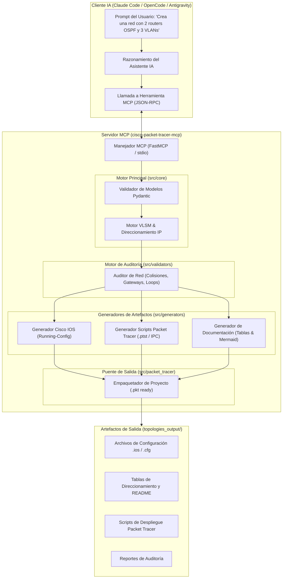

# 🏗️ Arquitectura del Sistema - Cisco Packet Tracer MCP

Este documento detalla la arquitectura de software del servidor **cisco-packet-tracer-mcp**, sus componentes principales, el flujo de datos y el pipeline de transformación desde los requerimientos en lenguaje natural hasta los artefactos de Cisco Packet Tracer.

---

## 1. Visión General de la Arquitectura

El servidor sigue el estándar **Model Context Protocol (MCP)** desarrollado por Anthropic, operando sobre un transporte de entrada/salida estándar (`stdio`) mediante mensajes JSON-RPC 2.0.

---

## 2. Capas del Software

### Capa 1: Transporte y Protocolo (`src/server.py`)
- Expone las herramientas y recursos mediante el protocolo MCP.
- Valida los argumentos recibidos desde el cliente IA contra esquemas JSON estrictos.
- Maneja excepciones y formatea respuestas legibles tanto para la IA como para el usuario final.

### Capa 2: Dominio y Modelado (`src/core/`)
- **`models.py`**: Modelos orientados a objetos construidos con **Pydantic v2**:
  - `Device`: Define routers, switches L2/L3, PCs y servidores.
  - `Interface`: Define puertos físicos, subinterfaces 802.1Q, direcciones IP, máscaras y estados.
  - `Link`: Conexión punto a punto o bus entre dos interfaces con tipo de cable (directo, cruzado, serial, fibra).
  - `VLAN`: Identificador (VID), nombre y subred asociada.
  - `RoutingProtocol`: Soporte para OSPFv2 (con áreas y wildcard masks), RIPv2 y rutas estáticas.
  - `NetworkTopology`: El grafo completo que representa la red entera.
- **`subnetting.py`**: Motor matemático de redes:
  - Descomposición automática de un bloque mayor (ej. `192.168.0.0/24` o `10.0.0.0/16`) usando **VLSM**.
  - Cálculo de gateway predeterminado, primera y última IP utilizable, y dirección de broadcast.

### Capa 3: Validación y Auditoría (`src/validators/`)
- **`topology_validator.py`**: Análisis estático de la topología antes de generar código:
  1. **Regla de IPs Duplicadas**: Asegura que ninguna IP se repita en la topología.
  2. **Regla de Coherencia de Enlace**: Verifica que los dos extremos de un enlace pertenezcan a la misma subred.
  3. **Regla de Default Gateway**: Comprueba que las PCs tengan como gateway una IP configurada en la misma subred (en el switch o router correspondiente).
  4. **Regla de Troncales y VLANs**: Verifica que si un enlace transporta VLANs, ambas interfaces estén en modo troncal y con encapsulación 802.1Q.
  5. **Regla de Seguridad Base**: Verifica que los dispositivos tengan configuradas contraseñas de consola, VTY y modo privilegiado secreto.

### Capa 4: Generación de Artefactos (`src/generators/`)
- **`ios_config.py`**: Renderiza scripts limpios de Cisco IOS listos para copiar y pegar en la CLI de Packet Tracer o cargar mediante TFTP.
- **`pt_script.py`**: Genera scripts de comandos o scripts para la consola de Packet Tracer que instancian los dispositivos y conectan los cables.
- **`documentation.py`**: Genera automáticamente la documentación técnica del proyecto:
  - Tabla de direccionamiento completa (en formato Markdown y CSV).
  - Diagrama de red en formato Mermaid.
  - Resumen ejecutivo de la topología.

---

## 3. Flujo de Ejecución de una Tarea

1. **Solicitud de la IA:** El cliente IA (ej. Claude Code) invoca la herramienta `create_network_topology` o `export_topology_package`.
2. **Validación de Esquema:** Pydantic valida que los nombres de los dispositivos, puertos y tipos sean válidos para Cisco Packet Tracer.
3. **Auditoría Preliminar:** Se ejecuta el motor de auditoría. Si existen errores críticos (ej. dos interfaces con la misma IP), la herramienta retorna un reporte detallado para que la IA corrija el diseño.
4. **Generación de Configuraciones:** Si la auditoría es aprobada, se sintetizan los archivos de configuración para cada router y switch.
5. **Persistencia en Disco:** Se crea una carpeta con sello temporal y nombre del proyecto en `topologies_output/`, dejando los archivos listos para abrir en Cisco Packet Tracer.
